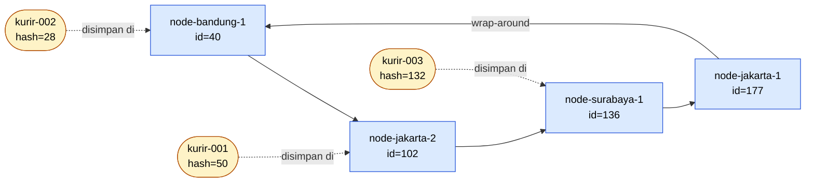
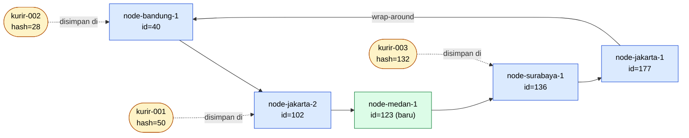
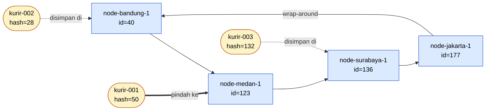

# Tugas 6 (Pekan 6) — Penamaan & Resolusi Lokasi

**Materi terkait:** Flat Naming, Structured Naming (DNS), Distributed Hash Table (DHT)/Chord.

## Studi Kasus

Pelanggan FoodGo kesulitan menemukan alamat IP server kurir yang **dinamis** (kurir berpindah lokasi/jaringan, IP-nya sering berubah). FoodGo butuh cara memetakan **ID Kurir** (identitas tetap) ke **alamat IP terkininya** tanpa server pusat tunggal yang jadi bottleneck/single point of failure.

## Tugas Kelompok

Implementasikan **simulasi Chord DHT** sederhana (single-process, tidak perlu jaringan sungguhan — cukup simulasi struktur data & algoritma di satu program Python) yang memetakan ID Kurir ke alamat IP mereka.

Konsep yang harus terlihat jalan dalam simulasi kalian:
1. **Consistent hashing**: ID Kurir dan ID Node di-hash ke ruang angka yang sama (mis. 0–255 untuk kesederhanaan, `m=8` bit).
2. **Ring topology**: node-node diurutkan melingkar berdasarkan hasil hash-nya.
3. **Lookup**: fungsi `lookup(kurir_id)` yang menemukan node mana yang bertanggung jawab menyimpan mapping ID Kurir tersebut → alamat IP-nya (aturan Chord: node dengan ID hash **terkecil yang lebih besar atau sama dengan** hash key, disebut *successor*).
4. **Perubahan topologi**: simulasikan minimal satu node baru bergabung (`join`) atau satu node keluar (`leave`), tunjukkan bagaimana mapping berpindah tanggung jawab ke node lain.

Skeleton disediakan di `src/chord_simulation.py` dengan fungsi hashing dan struktur ring sudah ada — bagian `lookup()`, `join()`, dan `leave()` sengaja dikosongkan.

### Cara Menjalankan

```bash
python3 src/chord_simulation.py
```

## Tugas Analisis (`README.md`)

1. Jelaskan **kenapa DHT/Chord** lebih cocok untuk kasus ini dibanding **flat naming sederhana** (mis. tabel pusat ID→IP) atau **DNS konvensional** — kaitkan dengan sifat "IP kurir sering berubah" dan kebutuhan tanpa titik gagal tunggal.
2. Gambarkan (boleh pakai Mermaid, lihat Tugas 2) ring topology dari simulasi kalian, tandai node mana yang bertanggung jawab atas ID Kurir mana.
3. Jelaskan apa yang terjadi pada mapping saat sebuah node **keluar** dari ring (siapa yang mengambil alih tanggung jawabnya) — dukung dengan output program.

## Analisis 1: Mengapa Chord DHT Lebih Cocok untuk Kasus FoodGo

Masalah FoodGo: ID kurir bersifat tetap, tetapi alamat IP-nya sering berubah karena kurir berpindah lokasi dan jaringan. Sistem harus bisa memetakan ID Kurir ke IP terkini tanpa server pusat tunggal yang menjadi bottleneck atau single point of failure. Berikut perbandingan tiga pendekatan.

### 1. Tabel pusat ID → IP (flat naming sederhana)

Semua kurir mendaftarkan dan memperbarui IP-nya di satu server, dan semua pelanggan melakukan lookup ke server yang sama. Karena IP kurir sering berubah, server ini menerima aliran update dan lookup yang terus-menerus, sehingga menjadi bottleneck. Jika server mati, tidak ada pelanggan yang bisa menemukan kurir sama sekali (single point of failure). Replikasi bisa membantu ketersediaan, tetapi menambah masalah konsistensi dan pengelolaannya tetap terpusat.

### 2. DNS konvensional (structured naming)

DNS memang terdistribusi, tetapi dirancang untuk nama hierarkis (misalnya `kurir.foodgo.com`) yang pemetaannya relatif jarang berubah. Resolusinya menelusuri hierarki dari root, TLD, lalu authoritative server, dan efisiensinya bergantung pada caching dengan TTL. Pada kasus ini muncul dilema:
- TTL panjang membuat resolver masih memakai IP lama setelah kurir pindah jaringan.
- TTL pendek membuat cache tidak efektif dan beban kembali menumpuk di authoritative server.

Selain itu, setiap zona tetap dikelola authoritative server tertentu, dan ID kurir adalah identitas datar (flat) yang tidak punya struktur hierarki untuk dipetakan ke zona DNS.

### 3. Chord DHT

Chord memakai consistent hashing, yaitu dimana ID kurir dan ID node di-hash ke ruang identifier yang sama, lalu node disusun melingkar. Setiap key disimpan di successor-nya, yaitu node dengan hash terkecil yang lebih besar atau sama dengan hash key. Sehingga pada kasus ini berdampak pada:
- **Tanpa titik gagal tunggal.** Tidak ada server pusat. Tanggung jawab menyimpan mapping tersebar ke banyak node, sehingga beban lookup dan update ikut tersebar.
- **Cocok untuk IP yang sering berubah.** Lokasi penyimpanan ditentukan oleh hash ID kurir, bukan oleh IP. Saat IP berubah, kurir cukup memperbarui mapping di node penanggung jawab yang sama (`register_kurir`), dan lookup tetap menuju node tersebut.
- **Tahan terhadap perubahan topologi.** Saat node join atau leave, hanya key milik node tersebut dan tetangganya yang berpindah. Dalam simulasi, saat `node-jakarta-2` keluar, hanya `kurir-001` yang berpindah ke `node-medan-1`, dan lookup tetap mengembalikan IP yang sama.

### Perbandingannya

| Aspek | Tabel pusat | DNS konvensional | Chord DHT |
|---|---|---|---|
| Titik gagal tunggal | Ada (server pusat) | Ada per zona (authoritative server) | Tidak ada |
| Beban lookup/update | Menumpuk di satu server | Menumpuk di authoritative server saat TTL pendek | Tersebar ke banyak node |
| Cocok untuk IP yang sering berubah | Update terpusat, rawan bottleneck | Terganjal TTL dan cache | Cocok, ID tetap dan lokasi simpan ditentukan hash |
| Jenis nama | Datar | Hierarkis | Datar |

## Analisis 2: Diagram 
### Diagram 1: Ring sebelum node-medan-1 bergabung



### Diagram 2: Ring setelah node-medan-1 bergabung



### Diagram 3: Ring setelah node-jakarta-2 keluar



## Analisis 3: Apa yang Terjadi pada Mapping Saat Node Keluar dari Ring

Pada simulasi, node yang keluar adalah `node-jakarta-2` (id=102). Sebelum keluar, node ini bertanggung jawab atas `kurir-001` (hash=50), karena node dengan id terkecil yang lebih besar atau sama dengan 50 adalah node 102. Dua kurir lain tidak berada di bawah tanggung jawabnya:

- `kurir-002` (hash=28) disimpan di `node-bandung-1` (id=40)
- `kurir-003` (hash=132) disimpan di `node-surabaya-1` (id=136)

### Cara kerja `leave()`

1. Program mencatat dulu key apa saja yang dipegang node tersebut, selagi node masih ada di ring.
2. Node dihapus dari `self.nodes`.
3. Untuk setiap key yang tadinya dipegang node itu, program mencari successor baru dengan `find_successor()`. Karena node 102 sudah tidak ada, node dengan id terkecil yang lebih besar atau sama dengan 50 adalah `node-medan-1` (id=123), yaitu node berikutnya searah jarum jam setelah node 102. Tanggung jawab atas `kurir-001` pun diambil alih oleh `node-medan-1`.

### Bukti dari output program

```text
[LEAVE] Node 'node-jakarta-2' (id=102) keluar dari ring
      key 'kurir-001' (hash=50, ip=192.168.1.10) berpindah dari node id=102 ke successor baru id=123
[LOOKUP] 'kurir-001' (hash=50) -> node penanggung jawab id=123 (10.0.0.5)
kurir-001 -> 192.168.1.10
[LOOKUP] 'kurir-002' (hash=28) -> node penanggung jawab id=40 (10.0.0.3)
kurir-002 -> 192.168.1.11
```

### Kesimpulan

- **Siapa yang mengambil alih:** successor dari node yang keluar, yaitu `node-medan-1` (id=123).
- **Lookup tetap berhasil:** `kurir-001` tetap mengembalikan IP yang sama (`192.168.1.10`). Yang berubah hanya node penanggung jawabnya, dari node id=102 menjadi node id=123.
- **Node lain tidak terpengaruh:** `kurir-002` tetap di node 40 dan `kurir-003` tetap di node 136. Perubahan topologi hanya berdampak pada key milik node yang keluar, bukan seluruh ring.

Ini dikarenakan penggunaan consistent hashing. Pada hashing biasa (misalnya hash dibagi jumlah node), perubahan jumlah node bisa memaksa hampir semua key dihitung ulang dan dipindahkan. Pada Chord hanya sebagian kecil key yang berpindah, sehingga sistem tetap bisa menjawab pencarian IP kurir tanpa gangguan berarti.

### Perbandingan dengan node yang bergabung

Ketika `node-medan-1` bergabung sebelumnya, tidak ada key yang berpindah. Hash `kurir-003` (132) lebih besar dari id node baru (123), sehingga masih menjadi tanggung jawab node 136. Node yang bergabung hanya mengambil key yang hash-nya jatuh di antara node sebelumnya dan dirinya sendiri.

    
## Struktur Submission

```
tugas-06-penamaan-dht/
├── README.md      # Analisis + diagram ring
├── JURNAL.md
├── src/
│   └── chord_simulation.py
└── bukti/          # Output program (screenshot/log) untuk skenario join & leave
```

## Rubrik Penilaian (Tugas 6)

| Komponen | Bobot | Kriteria |
|---|---|---|
| Implementasi lookup/join/leave benar | 35% | Consistent hashing & successor lookup sesuai aturan Chord |
| Bukti perubahan topologi (join/leave) | 25% | Output menunjukkan mapping berpindah dengan benar |
| Analisis kenapa DHT vs flat naming/DNS | 25% | Argumen spesifik ke kasus IP kurir dinamis, bukan definisi umum |
| Proses & kontribusi kelompok | 15% | `JURNAL.md`, commit history |

## Batasan Penggunaan AI (Level 2)

Kebijakan **Level 2 (AI Assisted Idea Generation & Structuring)** berlaku — lihat [`../RUBRIK-UMUM.md`](../RUBRIK-UMUM.md). Boleh bertanya konsep umum consistent hashing/Chord ke AI; **tidak boleh** meminta AI menuliskan isi `# TODO` di `src/chord_simulation.py` (`find_successor`, `join`, `leave`, dst). Catat pemakaian AI di "Log Penggunaan AI" pada `JURNAL.md`.

- `README.md` wajib menelusuri manual (langkah demi langkah) bagaimana `lookup()` menemukan successor untuk salah satu ID Kurir contoh yang dipakai di `chord_simulation.py` — bukan cuma menempelkan output program.
