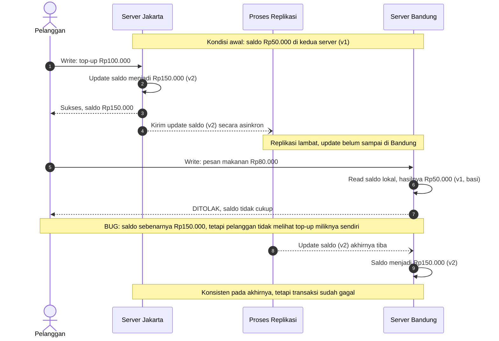
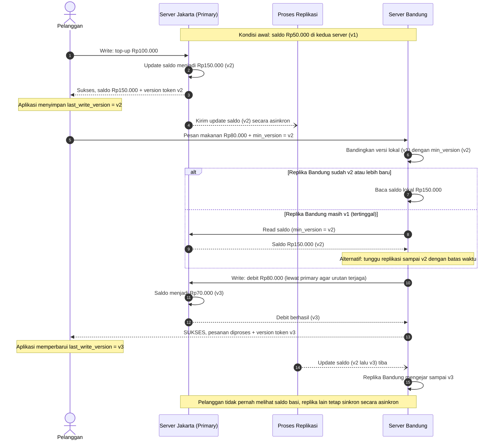

# Tugas 7 (Pekan 7) — Konsistensi Data

**Materi terkait:** Data-Centric Consistency (Sequential, Eventual), Client-Centric Consistency.

## Studi Kasus

Data saldo *e-wallet* pelanggan FoodGo berbeda antara server wilayah **Jakarta** dan **Bandung** karena replikasi antar server berjalan lambat. Contoh kasus nyata: pelanggan top-up saldo lewat server Jakarta, lalu dalam hitungan detik memesan makanan lewat aplikasi yang tersambung ke server Bandung — saldo belum ter-update, transaksi ditolak padahal saldo sebenarnya cukup.

## Tugas Kelompok

### Bagian 1 — Analisis (wajib)

1. Tentukan: apakah kasus ini **membutuhkan Sequential Consistency** (semua replika melihat urutan operasi yang sama) atau **cukup Eventual Consistency** (replika akan konsisten "pada akhirnya", boleh sementara berbeda)? Berikan argumen berbasis dampak bisnis (mis. kasus saldo *e-wallet* jauh lebih sensitif dibanding kasus "jumlah like" di media sosial).
2. Jika kalian menyimpulkan Eventual Consistency saja **tidak cukup** untuk skenario ini, usulkan pendekatan **Client-Centric Consistency** yang relevan (mis. *Read-Your-Writes*: pelanggan yang baru top-up harus selalu melihat saldo terbarunya sendiri, walau replika lain belum sinkron).
3. Gambarkan **diagram alir urutan (sequence diagram)** yang menunjukkan operasi read/write antara pelanggan, server Jakarta, server Bandung, dan proses replikasi — untuk skenario **tanpa** jaminan konsistensi (bug terjadi) DAN skenario **dengan** solusi yang kalian usulkan (bug teratasi). Pakai Mermaid (`sequenceDiagram`) di `README.md` — lihat contoh cara pakai di Tugas 2.

### Bagian 2 — Simulasi (opsional, nilai tambah)

Skeleton `src/replica_simulation.py` mensimulasikan dua replika (Jakarta & Bandung) dengan delay replikasi buatan. Lengkapi TODO untuk:
1. Menunjukkan kondisi **inconsistent read** (replika Bandung masih menunjukkan saldo lama walau Jakarta sudah update).
2. Mengimplementasikan mekanisme **Read-Your-Writes** sederhana (mis. dengan version/timestamp per client) yang memperbaiki masalah tersebut.

```bash
python3 src/replica_simulation.py
```

## Analisis Kelompok Bagian 1

### 1. Sequential Consistency atau Eventual Consistency?

**Kesimpulan**

Eventual Consistency saja **tidak cukup** untuk data saldo e-wallet FoodGo. Data saldo membutuhkan jaminan yang lebih kuat, yaitu urutan operasi yang ketat (setara Sequential Consistency) pada operasi tulis saldo. Data non-kritis tetap boleh memakai Eventual Consistency.

#### a. Argumen berbasis dampak bisnis

| Aspek | Saldo e-wallet | "Jumlah like" media sosial |
|---|---|---|
| Sifat data | Uang pelanggan (data finansial) | Metrik kosmetik |
| Dampak data basi | Transaksi ditolak padahal saldo cukup, atau saldo terpakai dua kali (*double spending*) | Angka terlambat beberapa detik, tidak ada pihak yang dirugikan |
| Risiko bisnis | Kehilangan pelanggan, komplain, kerugian finansial, turunnya kepercayaan | Hampir nol |
| Toleransi inkonsistensi | Sangat rendah | Tinggi |

#### b. Dua masalah dalam kasus ini

1. **Bug pada soal.** Pelanggan top-up lewat server Jakarta, lalu beberapa detik kemudian memesan lewat server Bandung. Replika Bandung belum menerima update, sehingga saldo yang terbaca masih lama dan transaksi ditolak. Pada Eventual Consistency, jeda seperti ini dianggap wajar karena replika hanya dijamin sama "pada akhirnya". Untuk uang, jeda ini merugikan pelanggan secara langsung.
2. **Risiko double spending.** Misalkan saldo Rp100.000 dan pelanggan memesan dari dua perangkat, satu lewat Jakarta dan satu lewat Bandung. Jika kedua server memvalidasi dari data lokal yang belum sinkron, keduanya bisa menyetujui dan saldo menjadi negatif. Risiko ini hanya bisa dicegah jika semua replika sepakat pada **urutan operasi yang sama** untuk data saldo, yaitu ciri Sequential Consistency.

#### c. Trade-off

Sequential Consistency penuh antar wilayah mahal:

- Setiap operasi harus dikoordinasikan antar server, sehingga latensi meningkat.
- Saat jaringan Jakarta dan Bandung bermasalah, sistem harus memilih antara menolak layanan atau menerima risiko inkonsistensi (CAP theorem).

#### d. Pendekatan yang diusulkan

| Jenis data / operasi | Jaminan konsistensi | Alasan |
|---|---|---|
| Tulis saldo (top-up, debit) | Urutan ketat (primary per akun atau replikasi sinkron), setara Sequential Consistency | Mencegah double spending dan menjaga urutan transaksi |
| Baca saldo oleh pemilik akun | Client-Centric: Read-Your-Writes | Pelanggan harus melihat hasil tulisannya sendiri |
| Data non-kritis (menu, rating, jumlah ulasan, promo) | Eventual Consistency | Cepat dan murah, ketidaksinkronan sementara tidak berdampak |

---

### 2. Pendekatan Client-Centric Consistency: Read-Your-Writes

Bug pada kasus ini adalah kesalahan Read-Your-Writes, yaitu dimana pelanggan menulis (top-up), lalu membaca (cek saldo saat memesan), tetapi tidak melihat hasil tulisannya sendiri.

Jaminan yang dibutuhkan adalah setelah pelanggan top-up, setiap pembacaan saldo oleh pelanggan yang sama harus mencerminkan top-up tersebut, di server mana pun ia terhubung. Replika lain boleh tetap tertinggal untuk pelanggan lain.

#### a. Mekanisme: version token

1. Setiap perubahan saldo menghasilkan nomor versi (version/timestamp) yang terus naik.
2. Setelah top-up, Jakarta mengembalikan saldo baru beserta versinya (misal `v2`). Aplikasi pelanggan menyimpannya sebagai `last_write_version`.
3. Setiap request baca/pesan menyertakan `min_version` = `last_write_version`.
4. Server Bandung membandingkan versi replika lokal dengan `min_version`:
   - Lokal ≥ `min_version` layani dari replika lokal.
   - Lokal < `min_version` (replika tertinggal) tunggu replikasi sampai versi cukup (dengan batas waktu), atau teruskan pembacaan ke Jakarta sebagai sumber otoritatif.
5. Debit saldo tetap ditulis lewat jalur berurutan (primary) agar double spending tertangani.

#### b. Dampak dari solusi

- Pelanggan yang baru top-up selalu melihat saldo terbarunya, sehingga transaksi tidak ditolak keliru.
- Replika lain tetap sinkron secara asinkron, sehingga sistem tidak melambat untuk semua pengguna.
- Risiko double spending tertangani lewat jalur tulis yang berurutan.

### 3. Sequence Diagram

Diagram berikut menggambarkan operasi read/write antara Pelanggan, Server Jakarta, Proses Replikasi, dan Server Bandung.

Asumsi skenario

| Parameter | Nilai |
|---|---|
| Saldo awal | Rp50.000 (versi `v1`, sama di Jakarta dan Bandung) |
| Top-up lewat Jakarta | Rp100.000 |
| Pesanan lewat Bandung | Rp80.000 |
| Saldo seharusnya setelah top-up | Rp150.000 (versi `v2`) |

#### a. Skenario A: Tanpa jaminan konsistensi (bug terjadi)

Replikasi berjalan asinkron dan lambat. Pelanggan memesan lewat Bandung sebelum update `v2` tiba, sehingga Bandung membaca saldo lama dan menolak transaksi.



Penjelasan:

- Langkah 1–3: top-up berhasil di Jakarta dan pelanggan menerima konfirmasi.
- Langkah 4: replikasi ke Bandung dikirim secara asinkron dan tertunda.
- Langkah 5–7: pesanan masuk ke Bandung yang masih memegang saldo `v1`, sehingga ditolak.
- Langkah 8–9: replika Bandung akhirnya konsisten, tetapi terlambat. Ini perilaku normal Eventual Consistency, namun merugikan pelanggan.

#### b. Skenario B: Dengan solusi Read-Your-Writes (bug teratasi)

Pelanggan membawa *version token* dari penulisan terakhirnya. Bandung memastikan datanya minimal sama baru dengan token tersebut sebelum memproses pesanan.



Penjelasan

- Langkah 1–4: top-up berhasil dan Jakarta mengembalikan *version token* `v2` yang disimpan aplikasi.
- Langkah 5–6: setiap request ke Bandung menyertakan `min_version = v2`. Bandung mendeteksi replikanya masih `v1`.
- Blok `alt`: Bandung tidak memakai data basi. Ia membaca dari Jakarta (atau menunggu replikasi) sampai versinya cukup.
- Langkah debit: penulisan saldo tetap lewat primary agar urutan operasi terjaga dan double spending tercegah.
- Langkah terakhir: token diperbarui ke `v3` dan replika Bandung menyusul secara asinkron.

#### c. Perbandingan kedua skenario

| Aspek | Skenario A (tanpa jaminan) | Skenario B (Read-Your-Writes) |
|---|---|---|
| Saldo yang dibaca Bandung | Rp50.000 (basi) | Rp150.000 (terbaru) |
| Hasil pesanan Rp80.000 | Ditolak | Berhasil |
| Pelanggan melihat tulisannya sendiri | Tidak | Ya |
| Jalur debit | Replika lokal | Primary (urutan terjaga) |
| Biaya tambahan | Tidak ada | Pengecekan versi, kadang forward/tunggu |

## Struktur Submission

```
tugas-07-konsistensi-data/
├── README.md      # Analisis konsistensi + sequence diagram Mermaid
├── JURNAL.md
├── src/            # (opsional) simulasi replikasi
└── bukti/          # (jika mengerjakan simulasi) output program
```

## Rubrik Penilaian (Tugas 7)

| Komponen | Bobot | Kriteria |
|---|---|---|
| Ketepatan pemilihan model konsistensi | 30% | Argumen berbasis dampak bisnis nyata, bukan hafalan definisi |
| Kualitas sequence diagram | 30% | Menunjukkan jelas titik kegagalan & titik perbaikan |
| Usulan solusi client-centric | 25% | Solusi konkret dan dapat diimplementasikan (bukan wacana abstrak) |
| Proses & kontribusi kelompok | 15% | `JURNAL.md`, commit history (+ bonus jika simulasi dikerjakan) |

## Batasan Penggunaan AI (Level 2)

Kebijakan **Level 2 (AI Assisted Idea Generation & Structuring)** berlaku — lihat [`../RUBRIK-UMUM.md`](../RUBRIK-UMUM.md). Boleh bertanya konsep umum consistency model ke AI untuk brainstorming; **tidak boleh** meminta AI menuliskan analisis akhir/sequence diagram atau isi `# TODO` di `src/replica_simulation.py` yang tinggal ditempel. Catat pemakaian AI di "Log Penggunaan AI" pada `JURNAL.md`.

- Sebagai bukti pemahaman konsep (bukan hafalan jawaban skenario FoodGo saja), `README.md` wajib menyertakan **satu skenario tambahan** yang kalian buat sendiri (mis. kasus lain di aplikasi ojek online) dan menentukan model konsistensi yang tepat untuk skenario tambahan tersebut.
